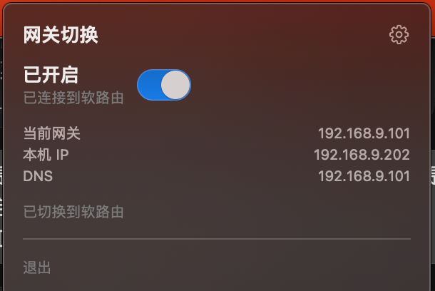
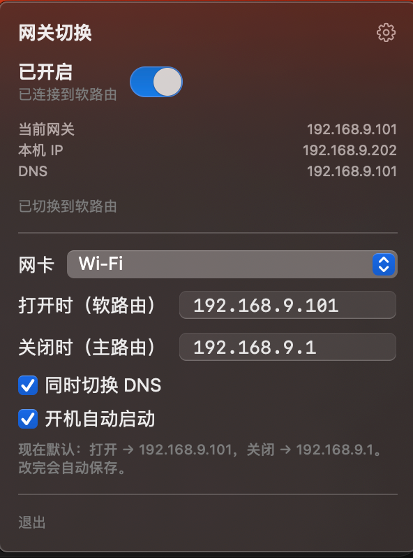

# 网关切换 GateSwitch

小而轻的 macOS 菜单栏工具：预先设好两个网关，点一下开关就能切换。

常见用法是在软路由和主路由之间切换这台 Mac 的出口。不想走软路由时关掉即可。没有账号，不联网，只改本机网关。

## 下载

现成的包在 [Releases](https://github.com/ming-wei187/GateSwitch/releases/latest)，不用自己编译。

1. 下载 zip，解压，把 `GateSwitch.app` 拖到「应用程序」（`/Applications`）
2. 第一次打开如果被拦住，在访达里右键应用，选「打开」；也可以在终端执行 `xattr -cr /Applications/GateSwitch.app`。这个包是临时签名，没有 Apple Developer ID
3. 第一次拨开关会要一次管理员密码，用来安装权限组件；之后再切换不会再问

需要 **macOS 13** 或更高版本。

## 界面

打开后是一个小面板，上面是开关，下面能看到当前网关、本机 IP 和 DNS：



右上角齿轮里可以改网卡、两个网关、是否同时切换 DNS，以及开机自动启动：



## 功能

- 菜单栏图标：一条线穿过中间的节点，表示网关方向。连着「打开时」的网关时是正常颜色，切回「关闭时」的网关时会淡一些
- 打开、关闭各对应一个网关，可在设置里填写
- 可选同时把 DNS 改成同一个地址
- 第一次切换时输入一次管理员密码，用来安装权限组件，之后再开关都不会再弹
- 可开机自动启动

## 安装

平时用上面的 Releases。要从源码编译：

```bash
./build.sh
```

会生成 `~/Applications/GateSwitch.app`，并做本地临时签名。打成可以上传到 Release 的 zip：

```bash
./package.sh
```

会先跑 `build.sh`，再把 `GateSwitch.app` 放进 `build/GateSwitch.zip`。

第一次使用先点齿轮，填好两个网关地址，再拨开关。

## 权限说明

修改网关需要管理员权限。第一次切换时，会安装一个只用于调用 `networksetup` 的辅助脚本（`/usr/local/libexec/soft-router-toggle`），并写入对应的 sudoers 规则。脚本只接受经过校验的参数，源码可以审计。

## 许可

MIT
